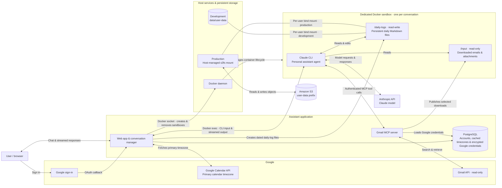

# Personal Assistant Agent

A personal assistant agent that currently integrates with Gmail. Connect your Google
account and chat with the assistant to find emails, read conversations, and retrieve
attachments. Gmail access is read-only.

The web app runs Claude Code in a dedicated sandbox for each conversation. The agent
uses Gmail MCP tools to access your mailbox and can download selected messages and
attachments for local analysis. Conversations last until reset, idle expiry, or an
app restart; chat history is not persisted. Each user also has persistent daily
Markdown logs mounted at `/daily-logs`. The app creates the dated files and Claude
reads and updates them; reset and sandbox cleanup preserve these entries. Local
development stores them in `data/user-data`, while production uses an S3-backed
filesystem mounted by s3fs on the host. Each sandbox receives a bind mount of its
user's daily-log directory. The app retrieves the primary Google Calendar timezone
and caches it in PostgreSQL to date these files in the user's local time, falling
back to UTC when unavailable.

## Architecture



The application controls sandbox lifecycle and Claude execution through the host's
Docker daemon socket. `/input` contains conversation-specific downloads, while
`/daily-logs` exposes persistent storage shared by the app and that user's sandbox.
The Calendar connection supplies timezone metadata; chat tools currently access
Gmail. In production, Caddy terminates HTTPS, and systemd starts the app only after
the daily-log mount is ready (see [deployment details](deploy/README.md)).

## Run locally

You need Docker with Compose, Python 3, and [uv](https://docs.astral.sh/uv/).

1. Create a Google OAuth **Web application** client, enable the Gmail and Google
   Calendar APIs, and register `http://localhost:8000/auth/google/callback` as a
   redirect URI. The current Google connection requests read-only access to both
   services; the chat assistant currently integrates with Gmail.
2. Copy `.env.example` to `.env`. Set the Google client credentials,
   `ANTHROPIC_API_KEY`, and `POSTGRES_PASSWORD`.
3. Generate `CREDENTIAL_ENCRYPTION_KEY` with:

   ```bash
   uv sync
   uv run python -c 'from cryptography.fernet import Fernet; print(Fernet.generate_key().decode())'
   ```

   Put the generated key in `.env`, and save the same database password as
   `POSTGRES_PASSWORD` in `deploy/local-db-password.txt` (ignored by Git).
4. Start Docker and run:

   ```bash
   ./deploy/local.sh
   ```

Open http://localhost:8000, sign in with Google, and ask the assistant a question.
Run the script again after source changes to rebuild. For direct Compose commands,
export both absolute host roots from the repository root:

```bash
export SANDBOX_HOST_INPUT_ROOT="$(pwd -P)/data/session-inputs"
export SANDBOX_HOST_USER_DATA_ROOT="$(pwd -P)/data/user-data"
```

`deploy/local.sh` initializes both roots with ownership `10001:10001` and mode
`0700`, preserving their contents on reruns. Compose binds them separately at
`/srv/assistant-agent/session-inputs` and `/srv/assistant-agent/user-data`. Use
`docker compose logs -f app` for logs and `docker compose down` to stop. For direct
host execution, set each `SANDBOX_APP_*_ROOT` to the matching absolute
`SANDBOX_HOST_*_ROOT` and create the directories with mode `0700`, owned by the
app runtime user. Never place either root inside the other.

The local script logs completed Claude messages by default, including email content
and tool results. Disable this with `CLAUDE_DEBUG_STREAM=false ./deploy/local.sh`.

The app resolves the day using the stored Google Calendar timezone, fetching the
primary calendar timezone when needed and falling back to UTC. Each request sends
Claude a current timestamp with UTC offset; the app uses that same timestamp to
create today’s file. Claude has editing permission scoped to `/daily-logs` and is
instructed to read existing entries first and preserve them. See the
[daily-logs plan](docs/dev-plans/daily-logs.md) for lifecycle and validation details.

## Development

Run checks with `uv run pytest -q` and `uv run ruff check .`.
See [AGENTS.md](AGENTS.md) for contribution guidelines and
[.env.example](.env.example) for configuration. Agent instructions live in
[`src/assistant_agent/agent_kit/`](src/assistant_agent/agent_kit/).

## Deployment

AWS infrastructure lives in [`terraform/`](terraform/), with deployment scripts in
[`deploy/`](deploy/README.md). After provisioning infrastructure and configuring secrets,
run `./deploy/deploy.sh --setup-s3fs` for first setup or deliberate binary repair.
Ordinary `./deploy/deploy.sh` only checks the installed s3fs binary before stopping the app.
Use one app worker/replica per deployment and one deployment
per application database.

Production startup is supervised by systemd after the EBS volume and daily-log
mount are ready. Two services own storage and the app; storage preparation runs in the
storage service. App startup recreates its direct bind against the ready mount.
Mount service failure stops the app; recovery is an explicit operator
action that retires its sandboxes before repairing storage. Terraform apply and
production deployment are separate rollout steps. Follow the
[storage operations runbook](docs/dev-plans/running-cli-inside-docker.md#production-daily-log-storage)
for startup, recovery, reboot checks, rollback, and S3 version recovery.

The instance role has S3 access limited to the application bucket’s `user-data`
prefix. **Accepted risk:** a sandbox that can reach instance metadata could obtain
that role and access other users’ logs. Metadata isolation remains a follow-up.
Writer coordination is also deferred: retain one instance/worker and avoid
overlapping a retiring conversation with a replacement writer for the same user.
